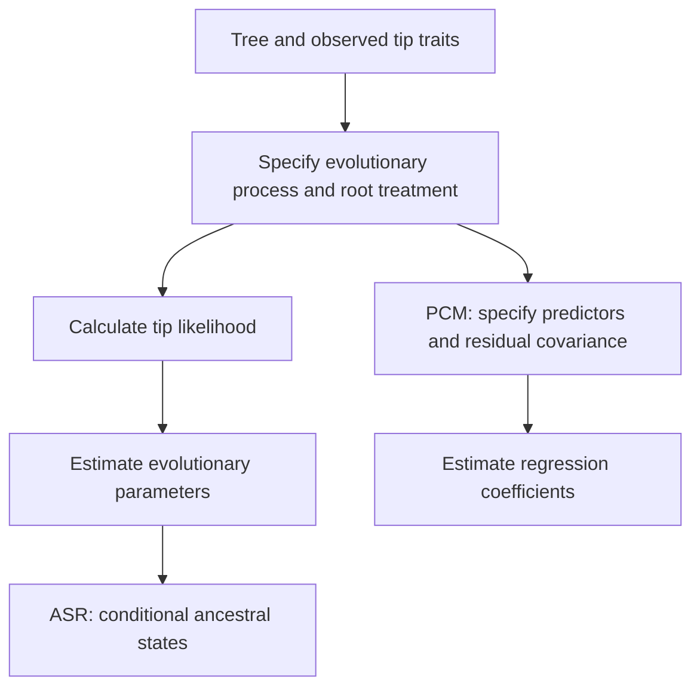

# ASR and PCM with Obuina

This tutorial connects the statistical models, their calculations and their use in Obuina **0.2.0**. It assumes a tree with observed or explicitly missing traits at its tips. Those traits may describe species, laboratory samples, cultural groups or other entities whose dependence can reasonably be represented by branching descent. A sequence alignment is optional.

Read the chapters in order, or use the question column to choose a starting point:

| Chapter | Question |
|---|---|
| This page | What do ASR and PCM infer, and what must the tree and metadata mean? |
| [Continuous traits](tutorial-continuous.md) | How do Brownian ASR, independent contrasts and PGLS relate? |
| [Discrete traits](tutorial-discrete.md) | How do likelihood and parsimony reconstruct categories and ordered states? |
| [Missing data and uncertainty](missing-data-and-uncertainty.md) | How are missing tips, several columns and noisy metadata handled? |
| [Extensions and pitfalls](tutorial-extensions.md) | How would OU, Pagel's $\lambda$ and other models extend this framework? What did Slater correct? |
| [Sources and implementation map](tutorial-references.md) | Which references and source files support the explanations? |

The mathematical derivations and numerical illustrations below describe the conventions used by this implementation. Related packages may choose different root distributions, rate normalisations or estimators. The shorter [method reference](methods.md) records API contracts; the [limitations document](limitations.md) tracks deferred work.

## 1. ASR and PCM ask related questions

**Ancestral state reconstruction**, ASR, estimates unobserved states at ancestral nodes from observed tip traits, a tree and an evolutionary model. A useful result includes uncertainty: a conditional distribution for a continuous value, a vector of probabilities for a category, or a set of equally optimal parsimony states.

**Phylogenetic comparative methods**, PCM, use the tree to account for dependence when studying trait evolution or relationships between traits. Examples include estimating an evolutionary variance, comparing evolutionary processes, and fitting a regression whose residuals retain phylogenetic covariance. ASR is often included within the broad PCM field; here we distinguish reconstruction from parameter estimation and regression to clarify their outputs.

For a probabilistic model with evolutionary parameters $\boldsymbol\eta$, observed tip data $\mathbf y$ and unobserved ancestral states $\mathbf z$, the likelihood is

$$
L(\boldsymbol\eta;\mathbf y,\mathcal T)
=\int p(\mathbf y,\mathbf z\mid\boldsymbol\eta,\mathcal T)\,d\mathbf z.
$$

Replace the integral by a sum for discrete ancestral states. A specified root state may be a fitted parameter instead of an integrated variable; the continuous chapter explains Obuina' separate fitting and reconstruction conventions. After fitting the evolutionary parameters, probabilistic ASR evaluates a conditional distribution such as

$$
p(z_v\mid\mathbf y,\widehat{\boldsymbol\eta},\mathcal T).
$$

A concentrated ancestral distribution says that the observations constrain that state under the supplied model. Assessing whether that evolutionary model fits the data requires additional diagnostics. Obuina currently supplies fitted likelihoods, reconstructions, contrasts and regression coefficients; its CLI does not yet supply model-selection tests or simulation-based fit diagnostics.



Parsimony uses a different objective: minimise the sum of specified transition costs. Its optimal-state sets carry no probabilistic calibration.

## 2. Define the trait before choosing the method

| Observation | Possible interpretation | Current Obuina method | Consequence |
|---|---|---|---|
| A real measurement | Approximately Gaussian increments along edges | `brownian`, `pic`, `pgls` | Differences and numerical scale have meaning |
| A class such as habitat or phenotype | Unordered finite states | `discrete` or unordered `parsimony` | Renaming categories leaves the substantive model unchanged |
| A rank or bounded integer level | Ordered, equally spaced states | Ordered `parsimony` | A change from 0 to 2 costs twice a change from 0 to 1 |
| A count | Continuous approximation or a count process | Continuous approximation only; ordered parsimony is another distinct choice | Distributional assumptions must be justified |
| Presence/absence | Two-state character | `discrete`, unordered `parsimony` | Current likelihood assumes equal forward/backward rates |

Coding classes as `0,1,2` does not automatically make them ordered. In the equal-rates CTMC, every pair of different states has the same instantaneous transition rate. Ordered parsimony uses the index distance explicitly. In Python, an ordered alphabet such as `[0, 2, 5]` gives three adjacent levels with unit spacing; use `[0, 1, 2, 3, 4, 5]` if the numerical gaps must count as several steps.

Brownian evolution can generate any real value. For positive measurements, a log transformation may be appropriate when proportional changes are plausible. Reconstructing a log trait and exponentiating its conditional mean gives a conditional median on the original scale. Under a Gaussian log-state distribution with mean $m$ and variance $v$, the corresponding original-scale mean is $\exp(m+v/2)$.

## 3. Define the tree and its units

Let $t_e$ be the length of edge $e$, $t_i$ the total root-to-tip depth of tip $i$, and $s_{ij}$ the depth of the most recent common ancestor, MRCA, of tips $i,j$. Their path distance is

$$
d_{ij}=t_i+t_j-2s_{ij}.
$$

An **ultrametric** tree has $t_i=T$ for every tip. A non-ultrametric tree permits unequal depths. **Every fitted ASR/PCM method currently implemented in Obuina accepts unequal depths.** PIC additionally requires a strictly bifurcating topology, and continuous methods currently require positive lengths.

What changes when depths differ depends on the process. Under Brownian motion, a deeper tip has accumulated more process variance. Under a stationary discrete CTMC, the marginal state frequencies can already be at equilibrium, while dependence across tips still varies with their connecting paths. The [Brownian covariance definition in ape](https://search.r-project.org/CRAN/refmans/ape/html/corBrownian.html) uses shared depths directly, without requiring equal tip depths.

Branch lengths need an interpretation consistent with the model. Time units give diffusion variance per unit time or state changes per unit time. Substitution lengths can instead serve as an evolutionary exposure scale if the trait process is plausibly proportional to that scale. OU attraction and time-dependent trends require particularly careful interpretation of this choice. A clustering dendrogram supplies distances chosen by a construction algorithm; an evolutionary interpretation needs separate justification.

Rescaling every edge from $t_e$ to $ct_e$ rescales the fitted Brownian variance rate to $\hat\sigma^2/c$, and the fitted discrete rate to $\hat r/c$. The corresponding transition distributions can remain unchanged. Absolute rates therefore depend on the declared branch units.

### Rooting

Newick always supplies a computational starting vertex. A biological root requires supporting information or an explicit assumption. With a defensible existing root, use the tree as supplied. After completing the directory setup in section 4, request midpoint rooting with:

```sh
build/obuina prepare --tree examples/tree.nwk --midpoint --prefix results/tutorial/rooted
```

Midpoint rooting places the root halfway along the longest weighted tip-to-tip path. Unequal evolutionary rates and unbalanced sampling can move that point away from the historical root. Obuina preserves taxon distances, suppresses unlabelled degree-two vertices and removes unary root stems, including labels on those removed stems. Labelled vertices elsewhere remain and may become unary, which prevents PIC until an appropriate topology is supplied.

The equal-rates CTMC is reversible with a stationary uniform root distribution. Its tip likelihood is unchanged by relocating an artificial root along an edge while preserving paths. That property does not identify historical direction. Ancestral interpretations still concern particular locations on a chosen rooted tree. Root treatment is also part of the continuous likelihood and uncertainty specification.

### Ultrametric conversion

After the same setup, request terminal extension with:

```sh
build/obuina prepare --tree examples/tree.nwk --extend-tips --prefix results/tutorial/equal-depth
```

With internal edges fixed, Obuina increases each terminal edge by

$$
a_i=H-t_i,\qquad H=\max_j t_j.
$$

This minimises total added length subject to equal tip depths and nonnegative terminal increments. It changes taxon distances and their implied covariance. Use it when that particular transformation is justified; the methods taught here can otherwise use the original unequal depths. Calibrated dating and general constrained ultrametric fitting remain deferred.

## 4. Set up the worked examples

Run shell snippets from the **Obuina project root**, the directory containing `readme.md`. These commands keep build and output files inside that directory:

```sh
cmake -S . -B build -DCMAKE_BUILD_TYPE=Release
cmake --build build -j 4
mkdir -p results/tutorial
```

The supplied [tree](../examples/tree.nwk) is

```text
((A:1,B:2)AB:1,(C:0.8,D:1.4)CD:1.5)root;
```

The [metadata](../examples/traits.tsv) contain:

| taxon | value | predictor | class | ordered |
|---|---:|---:|---|---:|
| A | 1.2 | 0.5 | low | 0 |
| B | 2.8 | 1.5 | high | 2 |
| C | 2.1 | 0.9 | low | 1 |
| D | 4.5 | 2.0 | high | 2 |

The actual input file uses tabs. Its row order can differ from the tip order, but supplied `taxon` names must match unique tree tips. Strict mode requires all taxa; `--missing estimate` allows missing tree-tip rows. Extra/duplicate taxa remain errors. The example depths are $2,3,2.3,2.9$; inspection reports a non-ultrametric tree:

```sh
build/obuina inspect --tree examples/tree.nwk --prefix results/tutorial/inspection
```

For discrete data, `?`, `NA` and an empty field indicate an unknown observation under either missingness policy. For continuous data, those markers and omitted tree-tip rows require `--missing estimate`. In Python, `None` represents an unknown value; `allow_missing=True` is required for continuous unknowns and omitted keys. The C API uses `NAN` for missing continuous values and `SIZE_MAX` for unknown exact discrete states. It indexes arrays by node ID and ignores internal-node observation entries; internal labels in Newick do not supply ancestral trait observations. The [missing-data guide](missing-data-and-uncertainty.md) explains why Brownian prediction, PIC omission and PGLS complete cases are different operations.

### Reading the common outputs

| File suffix | Contents |
|---|---|
| `.nodes.tsv` | Node ID, parent ID, label, tip flag, incoming length, observed/used flags and method-specific estimates |
| `.summary.tsv` | Method/trait, missing policy, observed/missing/used counts, tree checks, fitted parameters/scores and discrete alphabet |
| `.tree.nwk` | Analysed topology and lengths after any requested preparation |
| `.contrasts.tsv` | PIC contrasts and their variance factors |
| `.coefficients.tsv` | PGLS coefficients and standard errors |
| `.traits.tsv` | Trait-to-output manifest when `--traits` runs an independent batch |

`estimate` and `variance` apply to Brownian ASR. For discrete likelihood, `state` is the marginal mode and `p_i` gives the full marginal distribution. For parsimony, `state` belongs to one coherent optimum and `optimal_states` lists indices possible across global optima. The summary maps indices to labels through `state_i`. Empty fields mean the quantity does not apply. The root's incoming length is blank because root stems are ignored.

Node IDs refer to the analysed in-memory tree. Rerooting or reparsing a written Newick tree can change them. Use the node table's parent IDs and lengths to preserve the complete correspondence. A prefix replaces existing output files; its parent directory must already exist. Using prefixes also keeps PIC/PGLS's several tables in separate files.

To analyse several columns, supply `--traits value,predictor --prefix results/tutorial/columns`. Each trait receives its own output prefix and fitted parameters; no cross-trait covariance is estimated. PGLS can select several predictors with `--predictors x,z`. Observation-likelihood vectors for uncertain discrete metadata are available through C/Python; continuous measurement-error inputs remain future work.

## 5. Choose the next calculation

Use [Brownian ASR](tutorial-continuous.md#1-brownian-motion-along-a-tree) to estimate ancestral numerical states and an evolutionary variance rate. Use [PIC and PGLS](tutorial-continuous.md#5-independent-contrasts) to study numerical relationships while accounting for shared history. Use [discrete likelihood](tutorial-discrete.md#1-the-equal-rates-continuous-time-markov-chain) for probabilistic categorical reconstruction, or [parsimony](tutorial-discrete.md#6-parsimony-and-the-sankoff-recurrence) when an explicit transition-cost objective suits the question. The [extensions chapter](tutorial-extensions.md) explains what would change under OU, ordered CTMCs and alternative covariance models.
